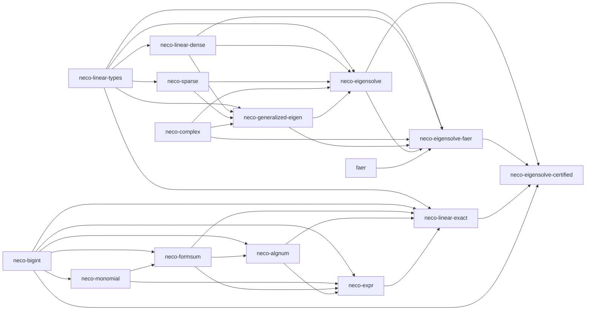

# neco algebra

[English](README.md)

neco algebra は、代数的数の厳密な計算と、数値線形代数を扱う Rust の crate 群です。厳密な計算では、数を式のまま保持し、浮動小数点値への近似は、誤差上限を付けて最後に一度だけ行います。数値線形代数では、固有値問題と連立一次方程式を浮動小数点で解き、一般化固有値問題で求めた固有値には、前進誤差の証明付きの上界を付けます。

厳密な計算では、値が零か、二つの値が等しいかを、正規形の構造を照合して判定します。たとえば次の等式では、左辺の積が正規化によって単一の項 `1` になるため、近似を使わずに、この等式が成り立つことが確定します。

$$
(\sqrt{3} + \sqrt{2})(\sqrt{3} - \sqrt{2}) = 1
$$

形式和 ( `neco-formsum` ) と代数的数 ( `neco-algnum` ) では、符号を二段階で決めます。まず、正規形だけから、値が零かを判定します。形式和では項の列が空であること、代数的数では最小多項式が $x$ であることが、零の条件です。零でなければ、厳密値を含む区間を必要な幅まで狭めて、符号を読み取ります。

## 依存関係

矢印は依存される crate から、その crate を利用する crate へ向きます。

## crate 一覧

- [`neco-bigint`](https://crates.io/crates/neco-bigint): 任意精度の自然数・整数・有理数、二進有理数、二進有理数を端点とする検証済みの包含区間
- [`neco-monomial`](https://crates.io/crates/neco-monomial): 有理数指数を持つ単項式による冪根の厳密表現
- [`neco-formsum`](https://crates.io/crates/neco-formsum): 正規化した単項式の有理係数和
- [`neco-algnum`](https://crates.io/crates/neco-algnum): 最小多項式と実根の番号で同定する実代数的数
- [`neco-expr`](https://crates.io/crates/neco-expr): 誤差上限付きの浮動小数点値へ解決する式のグラフ
- [`neco-complex`](https://crates.io/crates/neco-complex): 数値線形代数と信号処理で使う複素数のスカラー
- [`neco-linear-types`](https://crates.io/crates/neco-linear-types): 形状、ベクトル、線形作用素
- [`neco-linear-dense`](https://crates.io/crates/neco-linear-dense): 数値線形代数で使う密行列
- [`neco-sparse`](https://crates.io/crates/neco-sparse): 疎行列と、座標形式 ( COO ) から圧縮行形式 ( CSR ) への変換
- [`neco-generalized-eigen`](https://crates.io/crates/neco-generalized-eigen): 一般化固有値問題、固有空間、射影、収束状態を表す検証済みの型
- [`neco-eigensolve`](https://crates.io/crates/neco-eigensolve): 質量行列が単位行列である実対称問題を、Jacobi 法で決定的に解く固有値計算
- [`neco-eigensolve-faer`](https://crates.io/crates/neco-eigensolve-faer): `faer` を使って、対称一般化固有値問題と実の非対称固有値問題を解き、複素行列の LU 分解による求解と条件数の計算を行うアダプター
- [`neco-eigensolve-certified`](https://crates.io/crates/neco-eigensolve-certified): 一般化固有値問題に対する、前進誤差の証明付きの上界と、周波数の包含区間
- [`neco-linear-exact`](https://crates.io/crates/neco-linear-exact): 有理数、冪根、実代数的数に対する厳密行列、ガウス消去法、連立一次方程式の解

## このリポジトリを利用するリポジトリ

- [`neco-calculus`](https://github.com/barineco/neco-calculus): 厳密な多項式微積分
- [`neco-geometry`](https://github.com/barineco/neco-geometry): 実代数的数を座標とする厳密な幾何計算

## ランタイム構成

- `faer` に依存する二つの crate 以外: 既定では標準ライブラリを使い、既定機能を無効にすると `core + alloc` の構成で利用できる
- `neco-eigensolve-faer` と `neco-eigensolve-certified`: 標準ライブラリが必要

## ライセンス

MIT License です。[LICENSE](LICENSE) を参照してください。
