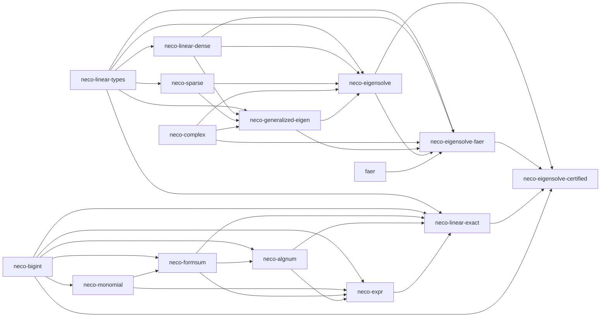

# neco algebra

[日本語](README-ja.md)

`neco algebra` is a set of Rust crates for exact arithmetic over algebraic numbers and for numerical linear algebra. In exact arithmetic, a number stays an expression and is approximated by a floating-point value only once, at the end, together with an error bound. In numerical linear algebra, eigenvalue problems and linear systems are solved in floating point, and the eigenvalues computed for generalized eigenvalue problems receive certified forward error bounds.

In exact arithmetic, whether a value is zero, and whether two values are equal, is decided by comparing the structure of their normal forms.
For example, the identity below holds without approximation, because normalization reduces the product on the left-hand side to the single term `1`.

$$
(\sqrt{3} + \sqrt{2})(\sqrt{3} - \sqrt{2}) = 1
$$

In the formal-sum (`neco-formsum`) and algebraic-number (`neco-algnum`) crates, a sign is decided in two steps.
First, the normal form alone decides whether the value is zero.
A formal sum is zero when its term list is empty, and an algebraic number is zero when its minimal polynomial is $x$.
If the value is nonzero, an interval enclosing the exact value is narrowed to the required width and the sign is read from it.

## Dependency graph

An arrow points from a dependency to the crate that uses it.

## Crates

- [`neco-bigint`](https://crates.io/crates/neco-bigint): arbitrary-precision naturals, integers, rationals, dyadic rationals, and validated enclosures with dyadic endpoints.
- [`neco-monomial`](https://crates.io/crates/neco-monomial): monomials with rational exponents that represent radicals exactly.
- [`neco-formsum`](https://crates.io/crates/neco-formsum): rational linear combinations of normalized monomials.
- [`neco-algnum`](https://crates.io/crates/neco-algnum): real algebraic numbers identified by a minimal polynomial and a real-root index.
- [`neco-expr`](https://crates.io/crates/neco-expr): expression graphs resolved to floating-point values with error bounds.
- [`neco-complex`](https://crates.io/crates/neco-complex): complex scalars for numerical linear algebra and signal processing.
- [`neco-linear-types`](https://crates.io/crates/neco-linear-types): shapes, vectors, and linear operators.
- [`neco-linear-dense`](https://crates.io/crates/neco-linear-dense): dense matrices for numerical linear algebra.
- [`neco-sparse`](https://crates.io/crates/neco-sparse): sparse matrices and conversion from coordinate format (COO) to compressed sparse row format (CSR).
- [`neco-generalized-eigen`](https://crates.io/crates/neco-generalized-eigen): validated types for generalized eigenvalue problems, eigenspaces, projectors, and convergence states.
- [`neco-eigensolve`](https://crates.io/crates/neco-eigensolve): deterministic Jacobi eigensolvers for real symmetric problems whose mass matrix is the identity.
- [`neco-eigensolve-faer`](https://crates.io/crates/neco-eigensolve-faer): an adapter that uses `faer` to solve symmetric generalized and real nonsymmetric eigenvalue problems, and to solve systems by the LU decomposition of complex matrices and compute their condition numbers.
- [`neco-eigensolve-certified`](https://crates.io/crates/neco-eigensolve-certified): certified forward-error bounds and frequency enclosures for generalized eigenvalue problems.
- [`neco-linear-exact`](https://crates.io/crates/neco-linear-exact): exact matrices, Gaussian elimination, and linear-system solutions over rational, radical, and real algebraic values.

## Repositories using this repository

- [`neco-calculus`](https://github.com/barineco/neco-calculus): exact polynomial calculus.
- [`neco-geometry`](https://github.com/barineco/neco-geometry): exact geometric computation with real algebraic coordinates.

## Runtime configuration

- Every crate except the two that depend on `faer`: uses the standard library by default, and can be used in a `core + alloc` configuration when default features are disabled
- `neco-eigensolve-faer` and `neco-eigensolve-certified`: require the standard library

## License

MIT License. See [LICENSE](LICENSE).
